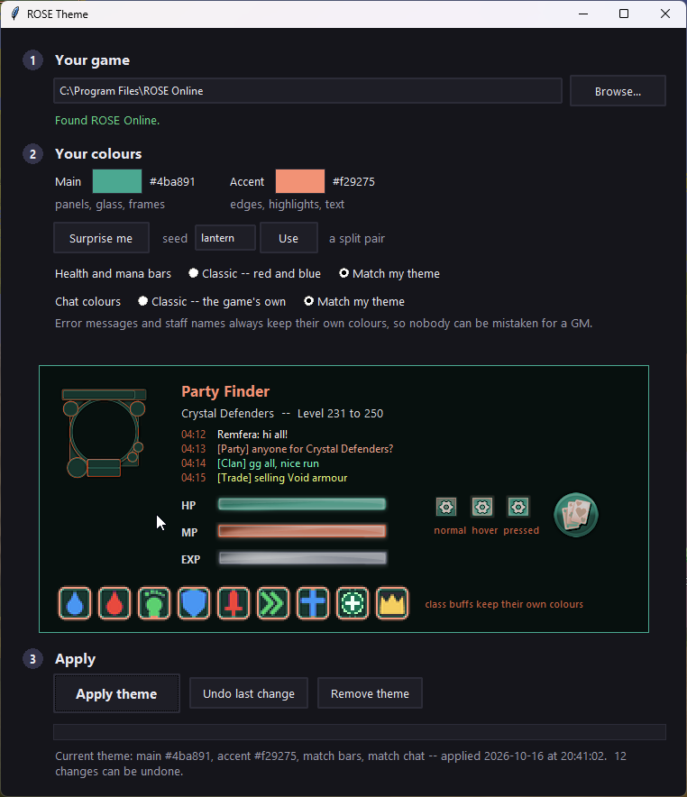
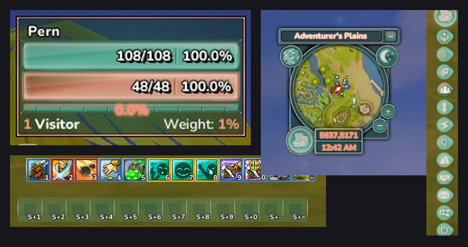

# ROSE UI Editor

Recolour the whole ROSE Online interface in two clicks — or let it surprise you.

### [⬇ Download ROSE UI Editor](https://github.com/OlarisMods/ROSE_UI_Editor/releases/latest/download/ROSE_UI_Editor.zip)

Unzip it anywhere and double-click `ROSE UI Editor.pyw`. Keep the files
together in their folder.

*(That link always gives you the newest version. You do not need a GitHub
account, and there is nothing to sign up for.)*

---

## What you need

**Python 3 for Windows**, from [python.org](https://www.python.org/downloads/).
That is the only requirement — the editor itself installs nothing and uses only
what Python ships with.

When you install Python, make sure **"tcl/tk and IDLE"** is ticked. It is on by
default. That is what draws the window, and without it the app will not open.

If double-clicking the `.pyw` does nothing, Windows does not know what to do
with the file type. Right-click it once, choose **Open with**, and pick Python.

---

## What it does

Pick two colours and it rebuilds the interface around them: window frames,
buttons, tabs, the chat box, the minimap ring, the sidebar, the gauges, the
party controls. Not a tint laid over the top — every piece of interface art is
redrawn in your colours, shading and all.

**Three steps.** Find the game (it looks in the usual places), pick a **main**
colour for panels and glass and an **accent** for edges, highlights and text,
then press **Apply theme**. The preview follows as you drag the colour picker.

**Surprise me** picks a matched pair for you. Every surprise has a **seed** — a
word like `ember` or `tidepool`. The same seed always gives the same theme, so
you can share a single word and anyone gets your colours. Type any word you
like. The hand-made themes are seeds too: `void`, `crimson`, `moldie`,
`ancient`.

**Health and mana bars** can stay classic red and blue, or match the theme.
**Chat colours** likewise. Error messages and staff names always keep their own
colours, so nobody can be mistaken for a GM.

Prefer a finished, hand-made theme? Those are in
[Kyio's ROSE Mods](https://github.com/OlarisMods/Kyio-s-Rose-Mods/blob/main/docs/ui-themes.md).

---

## Is this safe for my game?

Yes, and here is exactly why.

ROSE loads loose files in preference to the ones in its archives. This editor
only ever writes loose files into your game folder. **It never opens, edits or
damages `rose.vfs` or anything the game shipped with.**

**Nothing is ever lost.** Before it changes anything it copies every file it is
about to replace into its own folder, and writes down every file it adds:

    C:\Users\<you>\AppData\Local\ROSE Theme\

*(Still named after the editor's old name, "ROSE Theme", so backups made by
earlier versions keep working.)*

- **Undo last change** — back to how things were before your last Apply.
- **Remove theme** — back to how things were before the editor *ever* touched
  the game, including any other mods you had installed.

It will not write while the game is running, and if anything fails half way it
puts back what it had done so far.

It does not talk to the server, does not change how the game plays, and gives
no advantage. It changes colours.

**It is not an executable.** It is plain Python text files you can read in
Notepad, and every one of them is in this repository. There is no network code
anywhere in it. The one outside program it ever runs is Windows' own
`tasklist`, once, to check whether the game is open before writing — that is
the only use of `subprocess`. No `eval`, no downloads.

---

## Coming from an older UI pack?

Before the 16 October 2026 patch, every UI theme — ours and everyone else's —
shipped a copy of `data\ui\themes\rose\styles\spritesheet_glassui.css`. After the
patch, an old copy in your folder hides the game's new buttons: the group
manager button turns into a white square, and some icons go missing.

**The editor deletes that file for you when you apply a theme** (backed up, so
Undo brings it back). If you go back to installing packs by hand, check it is
not there.

---

## Will an update break it?

A big interface patch can. The editor carries a copy of the game's interface,
prepared for recolouring, and when the game moves its art around that copy has
to follow. The 16 October 2026 patch was exactly that, and this version is built
on it.

If a patch lands and something looks wrong — a button in the wrong place, a
window in the old colours — press **Remove theme** and the game is exactly as
Rednim shipped it. Then tell me, and I will rebuild.

---

## What is in this folder

| File | |
|---|---|
| `ROSE UI Editor.pyw` | the app — double-click this |
| `engine.py` | builds a theme from two colours |
| `theme_core.py` | reading and writing the game's textures and stylesheets |
| `theme_picker.py` | the colour picker |
| `preview.py` | the live preview, and Surprise me's seeds |
| `installer.py` | apply, undo and remove, with the backups |
| `base/` | the game's interface, in neutral grey, ready to recolour |
| `READ ME FIRST.txt` | the full guide, offline |
| `APP.md` | how it works inside, for the curious |

All must stay together. Plain Python, standard library only — no installer, no
downloads, no network access.

---

## Licence

MIT. See [LICENSE](LICENSE).

That covers **this editor's code only**. ROSE Online's textures, interface
files and every other asset belong to Rednim Games, and nothing here changes
that. The files in `base/` are the game's own interface art and stylesheets,
converted to neutral grey so they can be recoloured — the same kind of recolour
the hand-made UI themes have always been.
